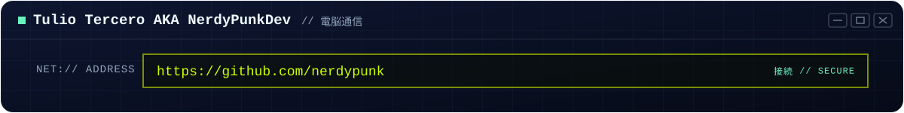

<code>起動 // WHATSUP, GREAT TO HAVE YOU HERE</code>

I'm **Tulio Tercero AKA NerdyPunkDev**, a solo developer from Tegucigalpa, Honduras, currently building **[Spaceman Memories](https://store.steampowered.com/app/2354580/Spaceman_Memories/)**. Wishlist it on Steam, it helps a ton.

I'm also the founder and creator of **[Saint Mike Node](https://github.com/SaintMikeNode)**, the **[Honduras Indie Game Showcase](https://nerdypunk.github.io/Honduras-Indie-Game-Showcase/)**, **[Pipodojo](https://pipodojo.com/)** and **[CopánQuest](https://copanquest.todosenlaweb.com)**. BTW, I'm also an OpenAI Codex Ambassador lol...

| Project | What it is |
|---|---|
| **[Spaceman Memories](https://store.steampowered.com/app/2354580/Spaceman_Memories/)** | My indie game, built solo |
| **[CopánQuest](https://github.com/SaintMikeNode/copanquest)** | 3D exploration of the Maya city of Copán |
| **[ReefQuest](https://github.com/SaintMikeNode/reefquest)** | Bilingual 3D web experience about the coral reefs of the Bay Islands of Honduras |
| **[Pipodojo](https://pipodojo.com/)** | A Duolingo-style app for AI agents |
| **[Honduras Indie Game Showcase](https://nerdypunk.github.io/Honduras-Indie-Game-Showcase/)** | A showcase of games made in Honduras |
| **[nerdypunk.dev](https://github.com/nerdypunk/nerdypunk.dev)** | This website's source |

<a href="https://twitter.com/NerdyPunkDev">TWITTER</a> &nbsp;//&nbsp;
<a href="https://www.nerdypunk.dev">WEBSITE</a> &nbsp;//&nbsp;
<a href="https://store.steampowered.com/app/2354580/Spaceman_Memories/">STEAM</a> &nbsp;//&nbsp;
<a href="https://www.saintmikenode.org">SAINT MIKE NODE</a> &nbsp;//&nbsp;
<a href="https://discord.gg/VZpnjtnHSc">DISCORD</a> &nbsp;//&nbsp;
<a href="https://www.youtube.com/@nerdypunkdev">YOUTUBE</a> &nbsp;//&nbsp;
<a href="https://www.twitch.tv/nerdypunkdev">TWITCH</a> &nbsp;//&nbsp;
<a href="https://ko-fi.com/nerdypunkdev">KO-FI</a>

<code>C:\NPD&gt; SIGNAL LOCKED _</code>

