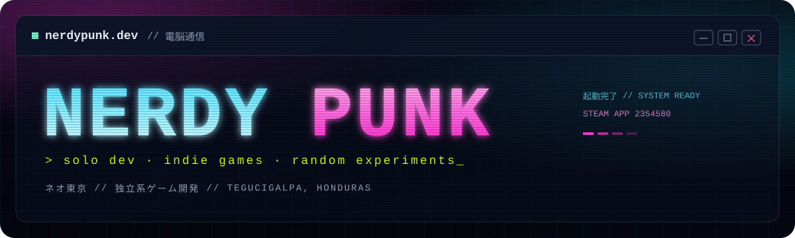

  

  
  
  
  
  
  

---

### `> whoami`

Hey, I'm **Tulio**, aka **NerdyPunkDev**. A solo developer from Tegucigalpa, Honduras, making indie games and random experiments, and sharing the process along the way.

I'm the founder of **[Saint Mike Node](https://github.com/SaintMikeNode)**, a community for people who create with technology, and the creator of the **Honduras Indie Game Showcase**. I'm also an OpenAI Codex Ambassador, lol.

### `> now_playing`

**[Spaceman Memories](https://store.steampowered.com/app/2354580/Spaceman_Memories/)**: my indie game, built solo. Wishlist it on Steam, it helps a ton.

### `> projects`

| | |
|---|---|
| **[CopánQuest](https://github.com/SaintMikeNode/copanquest)** | 3D exploration of the Maya city of Copán, free and educational |
| **[ReefQuest](https://github.com/SaintMikeNode/reefquest)** | Bilingual 3D web experience about the coral reefs of the Bay Islands of Honduras |
| **[Pipodojo](https://pipodojo.com/)** | A Duolingo-style app for AI agents |
| **[Honduras Indie Game Showcase](https://nerdypunk.github.io/Honduras-Indie-Game-Showcase/)** | A showcase of games made in Honduras |
| **[nerdypunk.dev](https://github.com/nerdypunk/nerdypunk.dev)** | My personal website, a retro cyber desktop in plain HTML, CSS and JS |

### `> stack`

  
  
  
  

ネオ東京 // 独立系ゲーム開発 // made with ♥ in Honduras

